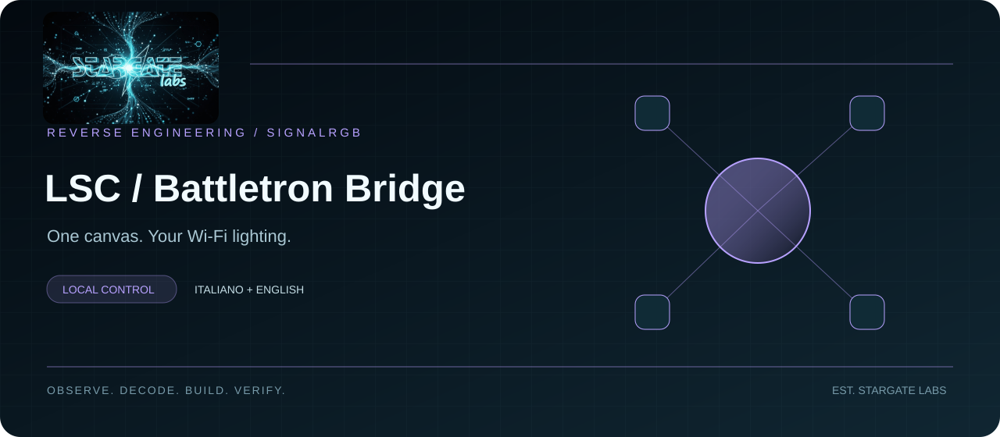

<b>STARGATE LABS · SIGNALRGB INTEGRATIONS</b> [Italiano](README.md) · [English](README.en.md) · [Installazione IT](docs/INSTALL-IT.md) · [Installation EN](docs/INSTALL-EN.md)

<a href="https://stargatelabs.github.io/signalrgb-lsc-battletron-bridge/index-en.html"><b>Project showcase ↗</b></a> &nbsp; · &nbsp; <a href="https://github.com/StargateLabs/signalrgb-lsc-battletron-bridge/releases"><b>Download</b></a>

# LSC Smart Connect / Battletron

A local bridge bringing LSC Smart Connect and Battletron Wi-Fi lights onto the SignalRGB canvas. The **LSC Battletron 2.0.17** desktop app LAN protocol was reconstructed through reverse engineering and verified against independent fixtures. QR login through the LSC app, LAN color streaming and device management in SignalRGB.

| Bridge | SignalRGB | Streaming |
|---|---|---|
| Rust · Windows | Standalone JS + QML controls | Up to 30 Hz · Ball DP24 capped at 10 Hz |

## Installation

Download the ZIP from [Releases](https://github.com/StargateLabs/signalrgb-lsc-battletron-bridge/releases), extract it and follow the [English installation guide](docs/INSTALL-EN.md). Rollback instructions are included.

## Architecture and verification

**61 Rust tests + 9 parity tests + 82 plugin checks**, plus release executable E2E. Latest local check: eight lights online, each receiving changing frames over 40 samples in 20 seconds. Synced configuration backups and verified recovery; automatic restart tested in about four seconds. No claim of universal optical latency.

## Known limits

Validated against the lab device group, not the entire Tuya/LSC catalog. Cloud credentials are used for login and keys; release may request a separate cloud OFF. The supervisor recovers an exited process, not a live but hung process. LotusLamp Bluetooth is not part of this release.

## Documentation and contributions

- [Technical notes / Note tecniche](docs/TECHNICAL-EN.md)
- [Changelog](CHANGELOG.md)
- [Third-party notices](THIRD_PARTY_NOTICES.md)
- [MIT license](LICENSE)
- [Stargate Labs](https://github.com/StargateLabs) · [Lab portfolio](https://stargatelabs.github.io/StargateLabs/)

Independent project, not affiliated with Razer, SignalRGB, Tuya or LSC. Trademarks belong to their respective owners.

Observe. Decode. Build. Verify. — Created by Stargate Labs.
